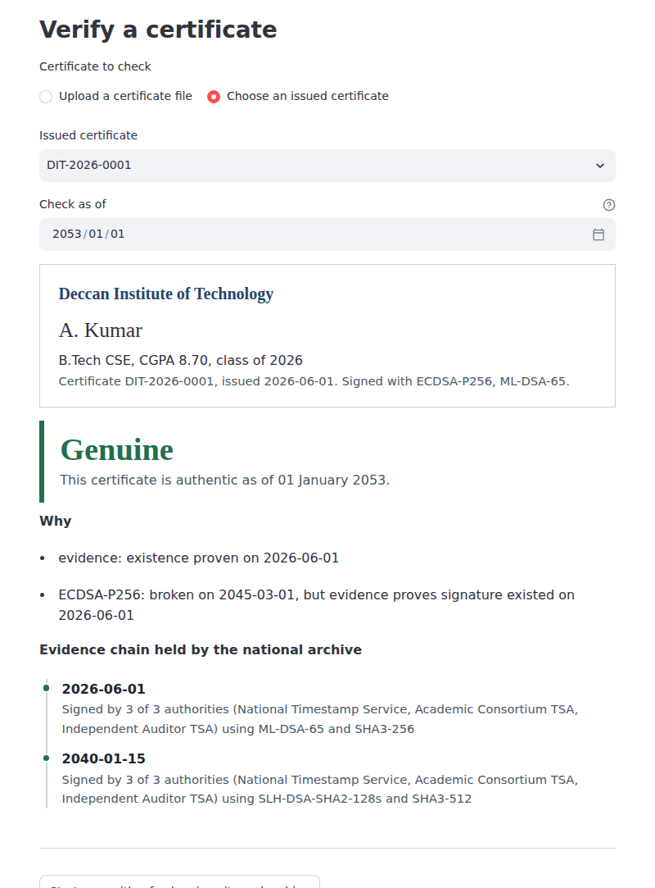

# qsafe-certs: quantum-safe, long-term academic certificates

Prototype for the research question: *how can a signed record stay verifiably
authentic for decades when the algorithms that sign it are broken and replaced?*

A university signs degrees with post-quantum signatures, each certificate can
carry several signatures from different algorithm generations, and a renewed,
timestamped evidence chain proves when each certificate existed. Every timestamp
is signed jointly by several independent authorities, and a verifier needs at least
*k* of them, so one stolen key or dishonest authority cannot backdate a forgery.
Simulated quantum key distribution (BB84) plus ML-KEM protects key transfer between offices.



*A degree issued in 2026 and checked in 2053, after both ECDSA (2045) and ML-DSA (2052) are treated as broken.
It is still genuine because the archive was renewed in 2040 with SLH-DSA by three independent authorities.
Without that renewal, the same certificate is rejected. All 14 recorded scenarios are in
[`screenshots/`](screenshots/results.md).*

## What it does

| Module | Role | Research question |
| --- | --- | --- |
| `qsafe/crypto.py` | ML-DSA, SLH-DSA (liboqs), ECDSA baseline, ML-KEM; self-tests each implementation before use | RQ4 |
| `qsafe/certificate.py` | Crypto-agile format: one certificate, many labelled signatures; issuer key directory | RQ1 |
| `qsafe/evidence.py` | Merkle-tree archive timestamps jointly signed by several authorities (k-of-n), renewal, chain verification (after RFC 4998) | RQ2, RQ3 |
| `qsafe/policy.py` | Which algorithm is broken from which date (simulated future), and how many timestamp authorities must agree | RQ1–3 |
| `qsafe/verifier.py` | Accepts a certificate if one signature is secure today, or evidence proves it predates the break | RQ1–3 |
| `qsafe/qkd.py` | Simulated BB84 with eavesdropper, hybrid QKD + ML-KEM key channel | RQ5 |
| `qsafe/registry.py` | Shared state for the web app: university, archive, timestamp authorities, policy | |
| `app.py` | Streamlit web app: issue, verify, simulate the future, key transfer | |
| `demo.py` | 2026 → 2052 scenario with simulated quantum breaks | |
| `diag.py` | Checks which post-quantum implementations work on this machine | |
| `benchmark.py` | Signature cost vs RSA/ECDSA; renewal cost for 1M certificates | |
| `experiments/threshold_study.py` | k-of-n timestamp authority study: cost, security and availability; writes `experiments/results/` | |
| `record_screenshots.py` | Drives the web app in a headless browser through 14 scenarios and saves screenshots | |
| `tests/` | 46 tests: security properties, multiple timestamp authorities, validation at renewal, algorithm identity, service layer, and web app flows | |

## Installation

The project needs Python 3.10+ and **liboqs**, the Open Quantum Safe C library,
which must be compiled once. Tested versions: liboqs 0.15.0, liboqs-python 0.16.0.2.

### Windows (tested on Windows 11, PowerShell in VS Code)

**1. Install the build tools** (one time):

```powershell
winget install --id Git.Git -e
winget install Microsoft.VisualStudio.2022.BuildTools --override "--wait --passive --add Microsoft.VisualStudio.Workload.VCTools --includeRecommended"
```

The second command installs the C++ compiler (a few GB). Close and reopen VS Code afterwards.
Check with `git --version`.

**2. Create the virtual environment and install Python packages:**

```powershell
cd "C:\Quantum projects\qsafe-certs"
conda deactivate                     # only if a (base) Anaconda prompt is active
python -m venv .venv
.venv\Scripts\Activate.ps1
pip install -r requirements.txt
pip install cmake
```

If PowerShell says running scripts is disabled, run
`Set-ExecutionPolicy -Scope CurrentUser RemoteSigned`, answer `Y`, and activate again.

**3. Build and install liboqs** (5–15 minutes):

```powershell
cd "C:\Quantum projects"
git clone --depth 1 --branch 0.15.0 https://github.com/open-quantum-safe/liboqs.git
cmake -S liboqs -B liboqs\build -G "Visual Studio 17 2022" -A x64 -DBUILD_SHARED_LIBS=ON -DOQS_BUILD_ONLY_LIB=ON -DCMAKE_WINDOWS_EXPORT_ALL_SYMBOLS=TRUE -DCMAKE_INSTALL_PREFIX="$HOME\_oqs"
cmake --build liboqs\build --config Release --parallel 8
cmake --install liboqs\build --config Release
Test-Path "$HOME\_oqs\bin\oqs.dll"   # should print True
```

**4. Tell Python where liboqs is** (once, then restart VS Code):

```powershell
[Environment]::SetEnvironmentVariable("OQS_INSTALL_PATH", "$HOME\_oqs", "User")
```

For the current terminal only: `$env:OQS_INSTALL_PATH = "$HOME\_oqs"`

### Linux, macOS or WSL

```bash
sudo apt install build-essential git cmake        # macOS: xcode-select --install; brew install cmake
cd qsafe-certs
python3 -m venv .venv
source .venv/bin/activate
pip install -r requirements.txt

git clone --depth 1 --branch 0.15.0 https://github.com/open-quantum-safe/liboqs.git ../liboqs
cmake -S ../liboqs -B ../liboqs/build -DBUILD_SHARED_LIBS=ON -DOQS_BUILD_ONLY_LIB=ON -DCMAKE_INSTALL_PREFIX=$HOME/_oqs
cmake --build ../liboqs/build --parallel
cmake --install ../liboqs/build
echo 'export OQS_INSTALL_PATH=$HOME/_oqs' >> ~/.bashrc && source ~/.bashrc
```

## Run

Each time you open a new terminal, activate the environment first
(`.venv\Scripts\Activate.ps1` on Windows, `source .venv/bin/activate` elsewhere).

```bash
python diag.py          # which post-quantum implementations work here
python demo.py          # 2026 -> 2052 scenario
python -m pytest -q     # expect: 46 passed
python benchmark.py     # signature and renewal costs
streamlit run app.py    # web app, opens at http://localhost:8501
```

A warning that liboqs 0.15.0 differs from liboqs-python 0.16.0.2 is expected and harmless.

## Web app

`streamlit run app.py` opens the app in your browser. Stop it with `Ctrl+C` in the terminal.

| Tab | What you can do |
| --- | --- |
| Issue | Issue a degree signed with ECDSA + ML-DSA; it is timestamped by the national archive; download it as a `.json` file |
| Verify | Upload a certificate file (and edit it to test tampering) or pick an issued one; choose a "check as of" date in the future |
| Simulate the future | Mark algorithms as broken from a date; choose how many timestamp authorities must agree (1, 2 or 3 of 3); renew the archive with chosen authorities; forge a backdated degree with a stolen ECDSA key, optionally with some authorities compromised |
| Key transfer | Run BB84 with an eavesdropper intercepting 0–100% of photons, then the hybrid BB84 + ML-KEM key exchange |

**Try this walkthrough:** issue a certificate dated 2026 → in *Simulate the future*, mark ECDSA broken from 2045 and ML-DSA from 2052 → in *Verify*, check it as of 2053: rejected → renew the archive in 2040 with SLH-DSA → check again as of 2053: genuine. Then forge a certificate and see it rejected. Forge again with one authority compromised: still rejected
(2 of 3 required). Set the requirement to 1 of 3 and repeat: the forgery is accepted, which is the weakness
a single trusted authority would have.

Everything is kept in memory; restarting the app, or clicking *Start over*, resets the university and archive.

## k-of-n timestamp authority study

`python experiments/threshold_study.py` (a few minutes) measures, for configurations from 1-of-1 to 4-of-5:
evidence size and signing/verification time; how many compromised authorities a backdated forgery needs,
by attacking the real code; how many authorities must be online at a renewal; and the resulting
probabilities. Results: `experiments/results/threshold_study.md` and two charts.

Main results (Linux sandbox): an attacker needs exactly **k** compromised authorities, and a renewal needs exactly
**k** online, in every configuration tested. With each authority compromised with probability 5% and online with
probability 95%, **3-of-5** is about 6× less likely than **2-of-3** to accept a forgery (0.12% vs 0.73%) and
6× less likely to fail a renewal (0.12% vs 0.72%), at the cost of 5 instead of 3 signatures per timestamp
(17 KB vs 11 KB per certificate per ML-DSA link; 41 KB vs 25 KB per SLH-DSA link).

## Screenshot test record

`record_screenshots.py` drives the running web app in a headless browser (Playwright), clicks through 14 test
scenarios, saves a screenshot of each, and writes `screenshots/results.md` with expected and actual verdicts.

```bash
pip install playwright
python -m playwright install chromium
python -m streamlit run app.py          # terminal 1
python record_screenshots.py            # terminal 2
```

Last recorded run (Linux sandbox, 2026-11-04): 10 of 10 verdict checks passed; 4 steps without a verdict completed.

| # | Scenario | Expected | Actual |
| --- | --- | --- | --- |
| 2 | Genuine certificate verified today | Genuine | Genuine |
| 3 | Uploaded certificate with CGPA edited 8.70 → 9.90 | Rejected | Rejected |
| 4 | Original file restored | Genuine | Genuine |
| 6 | Checked as of 2053, ECDSA and ML-DSA broken, archive not renewed | Rejected | Rejected |
| 8 | Checked as of 2053 after 2040 renewal (SLH-DSA, 3 authorities) | Genuine | Genuine |
| 9 | Forged degree with stolen ECDSA key, no evidence | Rejected | Rejected |
| 10 | Forgery backdated by 1 compromised authority, 2 of 3 required | Rejected | Rejected |
| 11 | Same forgery with only 1 of 3 required (old weakness) | Genuine | Genuine |
| 12 | Forgery backdated by 2 colluding authorities (design limit) | Genuine | Genuine |

Steps 1, 5, 7, 13 and 14 cover issuing, setting algorithm breaks, renewing, and BB84 with and without an
eavesdropper (25.6% error rate, detected).

## Demo scenario

1. **2026** A university issues degrees signed with ECDSA + ML-DSA. One ML-DSA timestamp, jointly signed by three independent authorities, covers the batch; any 2 of 3 must agree.
2. Tampering with a CGPA is rejected.
3. **2040** The archive is renewed with SLH-DSA and SHA3-512 (one joint timestamp for all records).
4. **2045** ECDSA is broken. Genuine degrees still verify. A forger with the university's ECDSA key creates a backdated degree: rejected, with or without a fresh timestamp, and even when one compromised authority backdates its timestamp. With a single trusted authority, that last forgery would have been accepted.
5. **2052** ML-DSA is also broken. Genuine degrees still verify via the renewed evidence chain; the same degree in an archive that was never renewed is rejected.
6. BB84 detects an eavesdropper (error rate ~22–27% vs 11% threshold); the hybrid channel transfers a key backup.

## Results: one laptop, two compiler builds

Intel Core i9-13900H laptop. **Windows:** Windows 11, liboqs built with Visual Studio 2022, Python 3.12.4, five runs.
**WSL:** Ubuntu 26.04.1 under WSL 2 on the same laptop (15.4 GB available), liboqs built with GCC 15.2, Python 3.14.4,
up to seven runs. Both use liboqs 0.15.0 and liboqs-python 0.16.0.2. Values are the range of per-run medians.

| Algorithm | Signature (B) | Sign (ms), Windows / WSL | Verify (ms), Windows / WSL |
| --- | --- | --- | --- |
| RSA-3072 | 384 | 1.32–1.36 / 1.33–1.46 | 0.035–0.036 / 0.033–0.034 |
| ECDSA-P256 | 70–72 | 0.020–0.022 / 0.019–0.023 | 0.078–0.083 / 0.076–0.083 |
| ML-DSA-65 | 3,309 | 0.366–0.381 / 0.081–0.090 | 0.097–0.100 / 0.035–0.042 |
| SPHINCS+-SHA2-128s-simple | 7,856 | 553–572 / 121–126 | 0.546–0.568 / 0.199–0.208 |
| SLH-DSA-SHA2-128s (FIPS 205) | 7,856 | fails to verify / 360–387 | — / 0.365–0.399 |

Windows results recorded before the algorithm-identity fix are labelled "SLH-DSA" but were measured with SPHINCS+
(see Findings). Raw outputs: `results/windows/` and `results/wsl/`.

Renewing 1,000,000 certificates: one timestamp signature; Merkle tree built in 5.2–5.3 s (Windows) and 3.2–3.5 s (WSL)
in pure Python; proof per certificate = 20 hashes (1,280 bytes).

### Running the benchmark

```bash
python benchmark.py                               # 5 runs, 1,000,000-certificate renewal
python benchmark.py --runs 3 --renew-size 100000  # quicker
```

It prints the machine's details (OS, CPU, cores, RAM, Python and liboqs versions), reports the median of
each measurement, and saves everything to `results_<os>_<date>_<time>.md` (to the second, so quick repeat runs never overwrite each other). Close heavy programs while it runs.

The **Verify, reused object** column times the library alone, without the project wrapper creating a
new verifier on every call. Comparing it with **Verify** shows how much of the cost is wrapper overhead.

## Findings so far

- **The compiler build, not the hardware, sets post-quantum performance.** On the same laptop, the GCC build ran ML-DSA
  about 4.3× faster to sign and 2.6× faster to verify, and SPHINCS+ about 4.6× and 2.7× faster, than the Visual Studio
  build, which disabled their AVX2-optimised code. RSA and ECDSA, from a separate library, were unchanged (a control).
  The overhead is in the library, not this project: wrapper and reused-object verification cost almost the same.
- **An algorithm name must mean one algorithm.** In the Visual Studio build, real SLH-DSA (FIPS 205) signed but never
  verified, and the code's self-test silently fell back to SPHINCS+, its pre-standard version, under the same name. They
  are not interchangeable (neither verifies the other's signatures), so evidence renewed on Windows would not have
  verified on Linux. The crypto layer now treats them as separate algorithms, never substitutes one for the other, and
  raises an explicit error when an algorithm has no working implementation. `diag.py` shows which is used.
- **The standardised scheme is currently the slower one:** liboqs 0.15 has no AVX2 option for FIPS 205 SLH-DSA, so under
  GCC it signs about 3× slower than SPHINCS+ (360–387 vs 121–126 ms).
- **Renewal validates before it extends**, matching the condition under which Geihs, Demirel and Buchmann (2015) prove
  ERS secure.
- **One trusted timestamp authority is a single point of failure;** 2 of 3 blocks a backdated forgery by one compromised
  authority, and 3-of-5 cuts forgery and renewal-failure risk about sixfold compared with 2-of-3.
- ML-DSA signs faster than RSA-3072, but its signatures are about 9× larger (3,309 vs 384 bytes).
- **Control test conditions.** An uncontrolled Windows run was 1.5–2× slower across the board. Publish medians.

To check which optimised code paths your own liboqs build enabled:

```powershell
Select-String -Path "C:\Quantum projects\liboqs\build\include\oqs\oqsconfig.h" -Pattern "avx2"
```

## Troubleshooting

| Error | Fix |
| --- | --- |
| `git` / `cmake` not recognized | Install it (step 1/2), then restart VS Code |
| `CMAKE_C_COMPILER not set` or `nmake` not found | C++ Build Tools missing; install them, delete `liboqs\build`, and use the `-G "Visual Studio 17 2022" -A x64` command |
| `No oqs shared libraries found` | liboqs not built, or `OQS_INSTALL_PATH` not set in this terminal |
| `No module named 'qsafe'` | Run commands from inside the `qsafe-certs` folder |
| pip warns about `streamlit` and `packaging` | Conflict with another project; use the `.venv` as above |
| `invalid TSA signature` in the demo | Old `crypto.py`; update to the self-testing version |
| `streamlit` not recognized | Activate `.venv`, then `pip install -r requirements.txt` |
| Verify says the archive holds no record | The app was restarted, so issued certificates were reset; issue a new one |

## Limitations

- BB84 is a classical simulation of the protocol's statistics, not quantum hardware; no error correction (Cascade).
- Algorithm "breaks" are simulated by the trust policy.
- Private keys live in memory; production would use HSMs.
- Timestamp trust is spread across 3 authorities with a 2-of-3 rule, but if 2 authorities collude (or 2 keys are
  stolen) they can still backdate a forgery. Larger, more independent sets of authorities, or anchoring
  timestamps in a public ledger, are future work.
- Authorities are trusted to sign only the current date; nothing in the simulation stops an authority from
  signing any date it is given.

## License

MIT License; see [`LICENSE`](LICENSE).

## How to cite

If you use this code or its results, please cite it using the **Cite this repository** button on the
GitHub page, which reads [`CITATION.cff`](CITATION.cff).

This is a research prototype. It is not hardened for production and must not be used to protect real
certificates or keys.